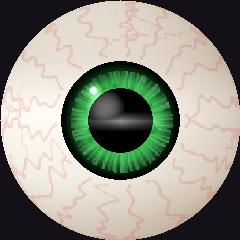
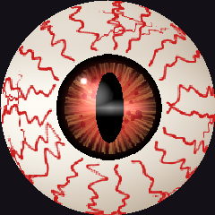
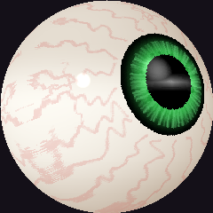
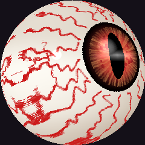
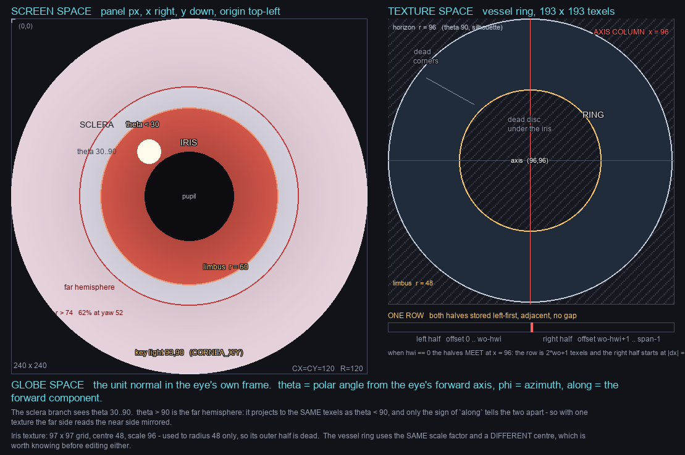

# Curious Eyeballs

An animated eye for a 240×240 round panel, written in C++ and built with
ESPHome. It looks around, blinks, and has scleral vessels baked from a fresh
random seed on every boot.

|  | calm | something in the room |
|---|---|---|
| **looking at you** |  |  |
| **looking away** |  |  |

Four frames of the same renderer, rendered headless, not screen grabs. Across
the row nothing changes but presence — colour, pupil, vessels, and how fast it
darts are all six parameters blending on one eased value, so the eye crosses
over rather than switching. Down the column nothing changes but where it is
looking.

The vessels are one possible bake. A real boot seeds from hardware entropy, so
the panel's differ every time.



## Requirements

- macOS
- A `.venv` with ESPHome in it (see below)
- For hardware: a C3-class board with a 240×240 round SPI panel, wired per
  `eye-device.yaml`

Both run scripts set the environment up themselves — a workspace-local `HOME`
and toolchain, plus one SCons fix. Use them rather than calling `esphome`
directly.

## Run it

```bash
./run-sandbox.sh    # an SDL window on this machine, no hardware needed
./run-device.sh     # build and flash the board over USB
```

`./run-device.sh --config-only` validates and compiles without touching the
hardware. To flash, hold BOOT, tap RESET, release BOOT.

If you have to call ESPHome directly, both exports matter:

```bash
export HOME="$PWD/.tmp/home"
export PATH="$PWD/.tmp/toolchain/bin:$PATH"
.venv/bin/esphome run eye-device.yaml
```

## Layout

| file | role |
|---|---|
| `eye-render.cpp` | the renderer — the whole eye, in one file |
| `eye-globals.yaml` | the animation state, shared by both targets |
| `eye-presence.yaml` | the presence driver, shared by both targets |
| `eye-device.yaml` | hardware config |
| `eye-sandbox.yaml` | local simulator config |
| `run-sandbox.sh` / `run-device.sh` | wrappers that set the environment |
| `tools/` | offline vessel model and the diagram generator |

The renderer is compiled as its own translation unit and called from each
config's display lambda.

## Before you change something

Read **[AGENTS.md](AGENTS.md)**. It records the constraints that look like bugs
but are not, the measured memory ceiling, and the vocabulary — screen, globe and
texture are three different spaces, and mixing them up has cost real time here.

Two things to know up front:

- **Memory is the binding constraint, and it is not predictable.** The display
  buffer needs 115,200 contiguous bytes and the board will not reliably give
  it. There is no model of when it fits. Compile, flash, and read whether
  `Buffer allocation failed` appears.
- **There are no tests.** Verification is: validate, compile, look at the
  window, flash and ask what the panel shows. The log cannot tell you whether
  it looks right.